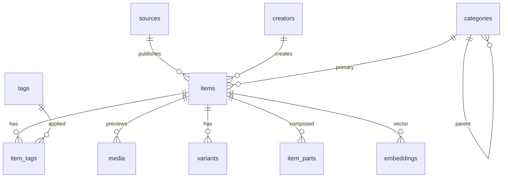

<!-- BEGIN:nextjs-agent-rules -->

## This is NOT the Next.js you know

This version has breaking changes — APIs, conventions, and file structure may all differ from your training data. Read the relevant guide in `node_modules/next/dist/docs/` (resolved from this file's directory; in monorepos the `next` package may not be visible from the repo root) before writing any code. Heed deprecation notices.

This block is written and re-added by `next dev` — verify at `node_modules/next/dist/server/lib/generate-agent-files.js`. Removing it from a diff only re-creates the uncommitted change; committing it with your work keeps the tree clean.

<!-- END:nextjs-agent-rules -->

# component-library

Working name. Next.js App Router catalog of UI components/blocks. No auth. Postgres + pgvector. Drizzle.

## Setup

```bash
cp .env.example .env
docker compose up -d --wait
npm install
npm run db:migrate
npm run db:seed
npm run dev          # http://127.0.0.1:4321
```

## Layout

| Path | Why |
| --- | --- |
| `app/` | App Router UI + `api/search`, `api/ingest`, `api/health` |
| `db/` | Drizzle client (`getDb`) |
| `drizzle/` | Schema + SQL migrations |
| `drizzle.config.ts` | drizzle-kit |
| `lib/catalog/` | Mapping, taxonomy, search, embeddings, ingest (unit-tested) |
| `proxy.ts` | Next.js 16 request proxy (replaces `middleware.ts`) |
| `aws/Dockerfile` | Unused fallback. Production is the arm64 zip |
| `infra/` | CDK stack, us-east-2, zip Lambda + CloudFront + Data API |
| `DEPLOY.md` | Ordered Mac deploy commands (profile `personal`) |
| `scripts/build-lambda.sh` | Apple Silicon–friendly standalone zip + static tree |
| `scripts/capture-previews.ts` | CLI: Playwright screenshots → `public/previews/` locally, or S3 with `PREVIEWS_BUCKET` |
| `functions/capture-previews.ts` | Lambda (x86_64) running the same capture in prod; core in `lib/catalog/capture-run.ts` |
| `app/@modal/` | Quick-view modal: intercepts `/items/[slug]` on soft navigation |
| `data/seed/components.json` | 62-record X scrape |

Owner apps (`family-graph`, stellar/gong) were private and not readable from this environment. This repo follows the paths they named: `aws/`, `infra/`, `buildspec.yml`, Drizzle like gong, `proxy.ts` + `next.config.ts` like family-graph.

## Data model

Core table is `items`. Required: `source_url`, `source_id`, `primary_category_id`. Optional: `creator_id`, `discovered_via_post_url`, `code`, `install_command`.



`item_parts(parent_item_id, child_item_id)` is block → component composition (`built from` / `used in`).

## Taxonomy and UI

`lib/catalog/taxonomy.ts` is the sidebar. Top-level nodes are sections, children are element types. Slugs are ids that items reference, so rename `name`, never `slug`; re-seed after edits (the seed deletes categories that left the tree and have no items). `mapScrapeCategory(category, type)` maps raw scrape labels through every node's name, slug, and `aliases`; a strong scrape `type` (tool, tutorial, component library…) wins over the category. Unknown labels land in `other`.

Every page reads the DB inside `<Suspense>`, after `connection()` (see `db/browse.ts`). `cacheComponents` is on: a top-level DB read crashes the route in production, and the RDS Data API client's random ids are refused during prerender.

## Previews

`media.source` is `scrape` (replaced on every re-ingest) or `capture` (our screenshots, kept). `pickPreview` prefers a capture. X, YouTube, and LinkedIn URLs are skipped (login walls). Cookie banners are hidden with CSS, never accepted. Files are content-hashed and served from `/previews/*`.

In production it's automatic. `POST /api/ingest` async-invokes the `CapturePreviews` Lambda with the ids it just wrote (batches of 10, `CAPTURE_FUNCTION_NAME`), and an EventBridge rule sweeps up to 25 uncaptured items daily. There's deliberately no frequent schedule: each run queries Aurora, and waking it from 0 ACU every half hour would cost more than the job. Locally `CAPTURE_FUNCTION_NAME` is unset, so ingest skips it; run `npm run previews:capture` (`--slug`, `--force`, `--limit`).

Lambda gotchas, all found by running the bundle in `public.ecr.aws/lambda/nodejs:22`: `@sparticuz/chromium`'s npm build is x64-only (hence x86_64), it's ESM-only (hence the ESM bundle + `require` banner in `infra/lib/stack.ts`), and it runs `--single-process`, where closing a context kills the browser (hence one browser per item). Keep `playwright`, `playwright-core`, and `@sparticuz/chromium` on matching Chromium majors (1.63.0 ↔ 153.0.0) when upgrading.

## Search

`lib/catalog/search.ts` + `db/queries.ts`:

1. Keyword: `ILIKE` + pg_trgm GIN on name/description, plus creator name/handle/slug
2. Creator facet: `creator=shadcn,animate-ui` (multi-select). Counts come from `listCreatorFacets`. Pages: `/creators`, `/creators/[slug]`
3. Hybrid (when `EMBEDDING_PROVIDER` works and `embeddings.text_embedding` is populated): cosine distance over pgvector, same filters applied
4. Stub provider throws `EmbeddingNotConfiguredError` and the query falls back to keyword

Creator inference (`lib/catalog/creators.ts`) prefers GitHub owner / known aliases (shadcn) over the X curator on roundup posts.

## Ingest

`POST /api/ingest` accepts one scrape record, an array, or `{ items, dryRun }`. Send public image URLs (e.g. the post's `pbs.twimg.com` media) in `image_paths`; local paths are ignored by the UI. Never generate placeholder `code`. Production requires `Authorization: Bearer $INGEST_SECRET`. Mapping lives in `lib/catalog/mapping.ts` so the scraper and seed share one path.

## AWS / cost

See `DEPLOY.md`. Zip Lambda (arm64) + CloudFront + S3 static + Aurora Serverless v2 Data API (min 0), no NAT. Host **ui-component-aggregator.com** (`www` → apex). Region **us-east-2**. Estimated **$4–14/mo** at light traffic.

## Commands

- `npm run lint` / `npm run typecheck` / `npm test`
- `npm run db:generate` after schema edits, then `db:migrate`
- Never commit `.env`
