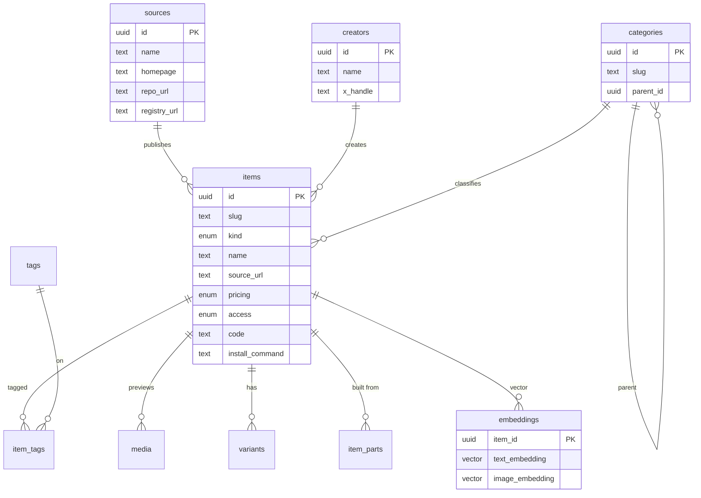

# component-library

Working name for a catalog of UI **components** and **blocks** scraped from designers (X, GitHub, shadcn registries, and library sites). Search-first, cheap to run on AWS, no auth.

Rename later by swapping `component-library` in `package.json`, `NEXT_PUBLIC_APP_NAME`, `infra/`, and `buildspec.yml`.

## Quick start

```bash
cp .env.example .env
docker compose up -d --wait
npm install
npm run db:migrate
npm run db:seed
npm run dev
```

App: [http://127.0.0.1:4321](http://127.0.0.1:4321)

Postgres (pgvector) listens on **5433** so it does not collide with a local 5432.

```bash
npm test
npm run lint
npm run typecheck
```

## What you get

- Mobbin-style browse: a persistent sidebar of ~70 UI element types (buttons, dropdown menus, dialogs, page sections, AI UI, effects…) grouped into collapsible sections with live counts, ⌘K search, and a screenshot grid
- Filter dropdowns for type, price, access, framework, creator, and style tags
- Quick view: clicking a card opens the item in a modal over the grid (intercepted route); the URL is shareable and a hard load renders the full page
- Item pages with a large preview, install command, the X post, details, and more from the same category
- `/creators` index and `/creators/[slug]` pages
- Light and dark mode (follows the OS until toggled)
- Preview screenshots of each item's live site: automatic in production (a Lambda invoked on ingest, plus a daily sweep), or `npm run previews:capture` locally
- `GET /api/search` (keyword now; hybrid keyword + pgvector when embeddings exist). `creator=shadcn,animate-ui` is a multi-select facet
- `POST /api/ingest` skeleton for the future daily X scraper
- Seed data from a 62-record X-bookmark scrape in `data/seed/components.json`. Creators are inferred from GitHub owner / known aliases (e.g. **shadcn**), not the X curator who posted a roundup.

## Data model

Everything hangs off **Item**. An item always has a `source_url` and a `source_id`. Creator and the discovering X post are optional. Categories are a strict tree; tags are loose.



Seeded taxonomy: Components (Buttons, Inputs, Cards, Navigation, Overlays, Data Display, Feedback, Charts), Blocks (Hero, Pricing, Features, Footer, Auth, Dashboard), AI & Agent UI (Chat, Diffs, Traces, Tool Calls), Animation / Effects, Backgrounds / Shaders, 3D.

## AWS

Production host is **ui-component-aggregator.com** (`www` 301s to apex). Exact Mac commands, secrets, and DNS: **[DEPLOY.md](DEPLOY.md)**.

| Piece | Choice |
| --- | --- |
| App | Node 22 arm64 zip + Lambda Web Adapter layer (no Docker/ECR) |
| Edge | CloudFront. ACM cert imported from us-east-1; no cert/DNS in the stack |
| Static | S3 origin for `/_next/static/*` + a secret `X-Origin-Verify` header |
| DB | Aurora PostgreSQL 16 Serverless v2, min 0 / max 1 ACU, **Data API**, no NAT |
| Region | **us-east-2** (account SCPs). Profile `personal`, account `848989864994` |
| Secrets | SSM `/component-library/INGEST_SECRET` (create before first deploy) |

Migrate and seed from the Mac with `npm run db:migrate:dataapi` and `npm run db:seed:dataapi`. Estimated **$4–14/mo** at light traffic. Do not add a NAT Gateway, Multi-AZ writer, or ALB.

## Env

See `.env.example`.

- `DATABASE_URL` — local compose default included
- `INGEST_SECRET` — required in production for `POST /api/ingest`
- `EMBEDDING_PROVIDER=stub` — keyword search only. Set `openai` + `OPENAI_API_KEY` for hybrid search once you backfill `embeddings`
- `APP_DOMAIN` / `APP_URL` — production host `ui-component-aggregator.com`. Unused on localhost.
- `AURORA_CLUSTER_ARN` / `AURORA_SECRET_ARN` / `AURORA_DATABASE` — RDS Data API (production migrate/seed)

## Ingest

```bash
curl -sS http://127.0.0.1:4321/api/ingest \
  -H 'content-type: application/json' \
  -H "authorization: Bearer $INGEST_SECRET" \
  -d '{"items":[{"component_name":"Example","demo_url":"https://example.com","type":"component"}]}'
```

The future X scraper should POST the same scrape-record shape as `data/seed/components.json`.

## Stubbed

- Semantic embeddings (provider interface + hybrid SQL path are in; no vectors until a provider is configured)
- Daily X scraper (ingest route only)
- Previews for items without a capturable site (X posts, videos): they keep a typographic placeholder unless the scrape sends a public image URL in `image_paths`
- Auth
- AWS resources (deploy from the Mac — [DEPLOY.md](DEPLOY.md); this environment does not deploy)
